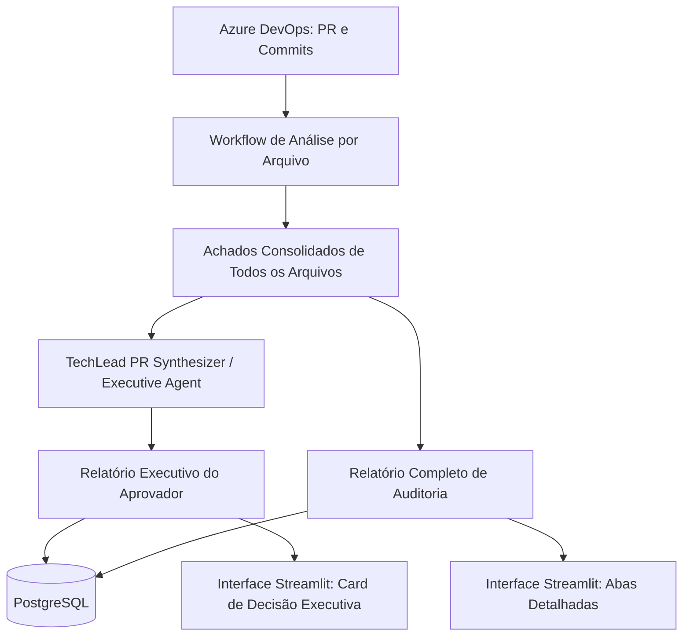

# 📋 Diagnóstico Arquitetural: Relatório Executivo para o Aprovador (Tech Lead Summary) vs. Relatório Completo

> **Data:** 03/11/2026  
> **Objetivo:** Projetar a separação e enriquecimento da experiência de revisão em dois níveis de leitura:
> 1. **Relatório Executivo (Para o Aprovador / Reviewer)**: Rápido, decisório, de alto impacto e leitura em menos de 1 minuto.
> 2. **Relatório Completo (Técnico / Detalhado)**: Auditoria linha a linha por aspecto (Estilo, Segurança, Performance, Testes e Parecer Tech Lead).

---

## 1. Análise da Sua Pergunta: "Esse segundo é só com o Agente TechLeader ou estou confusa?"

### Você **não está confusa**, sua intuição está certíssima!
O **TechLead** é exatamente o papel responsável por dar a decisão final da PR. Contudo, em engenharia de software e arquitetura de agentes, há uma diferença crucial entre:

1. **A Visão do TechLead por Arquivo isolado (Atual)**:
   - Hoje o TechLead olha o arquivo X e diz: "Aprovado" ou "Reprovado" com uma justificativa pontual.
2. **A Visão Executiva Consolidada da PR como um Todo (O que o aprovador precisa)**:
   - Um aprovador de PR (humano ou lead) **não quer** ler arquivo por arquivo primeiro.
   - Ele quer uma **visão holística (Executive Summary)**:
     - *Qual é o risco geral dessa PR para a esteira e produção? (Alto/Médio/Baixo)*
     - *Quais são os "Blockers" (impedimentos inegociáveis) vs. "Nitpicks" (sugestões de melhoria)?*
     - *Por que ela foi Aprovada ou Reprovada em 3 tópicos diretos?*
     - *Quais testes ou ações o autor deve fazer antes de fazer merge?*

Portanto, a solução mais elegante e poderosa é:
- O **Agente TechLead** atuar como um **Consolidador Executivo da PR** (recebendo os achados de todos os arquivos ou gerando o veredito macro da PR).
- Gerar **2 artefatos visuais / relatórios**:
  - `PR-{id}_resumo_executivo.md` (ou visualizado no topo da tela).
  - `PR-{id}_completo.md` (para quando o desenvolvedor for corrigir ou o revisor quiser ver o detalhe de uma linha).

---

## 2. Comparativo dos Dois Relatórios

| Característica | 🎯 Relatório Executivo (Aprovador) | 🔬 Relatório Completo (Técnico) |
| :--- | :--- | :--- |
| **Público-alvo** | Tech Lead, Revisor Sênior, Gestor | Autor da PR, Desenvolvedor responsável |
| **Tempo de leitura** | **30 a 60 segundos** | 5 a 15 minutos |
| **Foco principal** | Decisão de Merge, Riscos de Produção, Blockers | Snippets de código, estilo, testes, regras de linting |
| **Conteúdo** | • Veredito Final (Aprovado / Reprovado)<br>• Nível de Risco (Baixo / Médio / Alto)<br>• Principais Bloqueios (Top 3)<br>• Checklist para aprovação | • Detalhamento de cada arquivo modificado<br>• Apontamentos de Segurança, Estilo, Perf e Testes<br>• Linhas de código afetadas |
| **Papel do TechLead** | **Protagonista** (Sintetiza e toma a decisão geral) | Avalia a coerência arquitetural de cada arquivo |

---

## 3. Arquitetura Proposta da Nova Feature

### 3.1. Fluxo de Geração



### 3.2. Estrutura Proposta para o Relatório Executivo

```markdown
# ⚡ Sumário Executivo para o Aprovador - PR #85555
> **Decisão:** 🔴 REPROVADO | **Nível de Risco:** 🚨 ALTO | **Tempo de Leitura:** ~1 min

### 🎯 Resumo da Decisão
A PR introduz suporte ao Azure Foundry, porém inclui uma brecha de segurança crítica 
(fallback de segredo JWT em código) e risco de supply chain no manifesto de dependências.

### 🛑 Principais Bloqueadores (Must Fix antes do Merge)
1. **[Segurança]** `shared.module.ts`: Remover fallback hardcoded `process.env.JWT_SECRET || 'secret'`.
2. **[Dependências]** `package.json`: Substituir URL direta do CDN do SheetJS por versão via registro npm verificado.

### 💡 Recomendações Secundárias (Opcional / Não-bloqueante)
- Unificar bibliotecas de IA redundantes (`@google/genai` vs `genkit`).
- Extrair boilerplate repetido nos testes de `azure-openai-client.spec.ts`.

### 📋 Veredito do Aprovador:
[ ] Rejeitar PR e solicitar ajustes acima
[ ] Aprovar com ressalvas
```

---

## 4. Impactos no Código e Banco de Dados

1. **Agentes (`src/agents/tech_lead_agent.py` ou `summary_agent.py`)**:
   - Criar uma função/prompt onde o TechLead consome o resumo de todos os arquivos analisados e gera o parecer executivo consolidado da PR.
2. **Gerador de Relatórios (`src/utils/report_generator.py`)**:
   - `generate_executive_report(...)` -> gera `PR-{id}_{timestamp}_executive.md`
   - `generate_markdown_report(...)` -> mantém o relatório completo detalhado.
3. **Persistência (`src/db/repository.py`)**:
   - Salvar o texto do sumário executivo diretamente na tabela `pull_requests` (coluna `executive_summary TEXT`).
4. **Interface Visual (`app.py`)**:
   - Ao terminar a análise, o **Relatório Executivo aparece em destaque no topo** com badges e botões de ação rápida.
   - Um toggle/botão permite expandir o **Relatório Técnico Completo**.

---

## 5. Próximos Passos Sugeridos

1. Criar o consolidor executivo no workflow.
2. Adicionar o formato de relatório executivo rápido.
3. Exibir o relatório executivo como primeira tela no Streamlit e no CLI.
